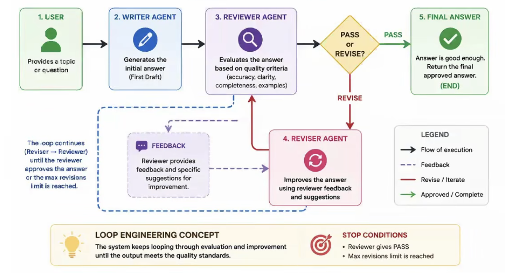

# Loop Engineering: Self-Correcting Multi-Agent Loop

A small LangGraph app where three agents work together until the answer is good enough:

1. **Writer** drafts a beginner-friendly explanation of a topic.
2. **Reviewer** checks the draft against a fixed set of rules and returns `PASS` or `REVISE` with feedback.
3. **Reviser** rewrites the draft using that feedback, then sends it back to the reviewer.

The loop stops when the reviewer says `PASS` or when the revision limit (`MAX_REVISIONS`) is reached. You can use it from a web UI (FastAPI) or from the terminal.



## How the loop works

```
START → writer → reviewer ──PASS──────────────→ END
                    ↑   └──REVISE──→ reviser
                    └──────────────────┘
```

| Node | Role | Output |
|---|---|---|
| `writer` | Writes the first draft (120–160 words, simple language, one analogy, one tiny example) | `draft` |
| `reviewer` | Strict verifier using structured output (`Review` Pydantic model) | `decision`, `feedback` |
| `reviser` | Improves the draft using the reviewer's feedback | new `draft`, `revision_count + 1` |
| `route_after_review` | Loop controller: ends on `PASS` or when `revision_count >= MAX_REVISIONS`, otherwise routes to `reviser` | — |

The reviewer's rules:

- beginner-friendly
- 120–160 words
- simple language
- one everyday analogy
- one tiny example

Shared graph state:

```python
class State(TypedDict):
    topic: str
    draft: str
    feedback: str
    decision: str        # "PASS" | "REVISE"
    revision_count: int
```

## Project structure

```
Loop_Engineering/
├── backend.py          # LangGraph graph, agents, run_workflow(), CLI demo
├── app.py              # FastAPI server (UI + JSON API)
├── templates/
│   └── index.html      # UI markup
├── static/
│   ├── style.css       # styling and animations
│   └── app.js          # calls the API and replays the agent trace
├── img.png             # architecture diagram
├── requirements.txt
└── .env                # API keys and config (not committed)
```

## Setup

Requires Python 3.10+ and [uv](https://docs.astral.sh/uv/).

```bash
cd Loop_Engineering
uv venv
source .venv/bin/activate
uv pip install -r requirements.txt
```

Create a `.env` file in `Loop_Engineering/`:

```env
GROQ_API_KEY=your_groq_api_key
GROQ_MODEL=openai/gpt-oss-120b   # optional, this is the default
MAX_REVISIONS=2                  # optional, this is the default
```

| Variable | Required | Default | Purpose |
|---|---|---|---|
| `GROQ_API_KEY` | yes | — | Groq API key ([console.groq.com](https://console.groq.com)) |
| `GROQ_MODEL` | no | `openai/gpt-oss-120b` | Groq model used by all three agents |
| `MAX_REVISIONS` | no | `2` | Maximum reviser passes before the loop gives up |

## Run

### Web UI

```bash
python app.py
```

Open http://127.0.0.1:8000, type a topic (or pick an example), and press **Enter**.

The UI shows:

- the agent graph, which animates as each node runs
- a step-by-step trace of every draft and review
- stats: revisions, verdict, steps and time
- the final answer, with a word-count bar against the 120–160 target

The server uses auto-reload, so code changes are picked up without restarting.

### CLI

```bash
python backend.py
```

Enter a topic when asked (press Enter for the default, "What is an AI Agent?"). Each agent's output is printed in order, followed by the final answer.

## API

### `POST /api/run`

Runs the full loop and returns every step.

```bash
curl -X POST http://127.0.0.1:8000/api/run \
  -H "Content-Type: application/json" \
  -d '{"topic": "What is an AI Agent?"}'
```

Response:

```json
{
  "topic": "What is an AI Agent?",
  "events": [
    { "agent": "writer",   "draft": "...", "decision": "",       "feedback": "",    "revision_count": 0 },
    { "agent": "reviewer", "draft": "",    "decision": "REVISE", "feedback": "...", "revision_count": 0 },
    { "agent": "reviser",  "draft": "...", "decision": "",       "feedback": "",    "revision_count": 1 },
    { "agent": "reviewer", "draft": "",    "decision": "PASS",   "feedback": "",    "revision_count": 1 }
  ],
  "final_answer": "...",
  "final_decision": "PASS",
  "revision_count": 1,
  "provider": "Groq",
  "model": "openai/gpt-oss-120b"
}
```

| Status | When |
|---|---|
| `200` | Loop finished. `final_decision` is `REVISE` if the revision limit was hit before a `PASS`. |
| `422` | `topic` is missing, empty, or longer than 300 characters. |
| `500` | The workflow raised an error, for example a bad API key. `detail` contains the message. |

Other routes: `GET /` serves the UI, and `GET /health` returns `{"status": "ok"}`.

## Key ideas

- **Verifier in the loop:** a separate reviewer agent decides whether output is good enough, instead of trusting the first draft.
- **Structured output:** the reviewer returns a typed `Review` object (`with_structured_output(..., method="json_schema")`), so routing never depends on parsing free text.
- **Bounded loop:** `MAX_REVISIONS` guarantees the graph stops even if the reviewer never says `PASS`.
- **Streaming updates:** `graph.stream(..., stream_mode="updates")` captures each node's output, which feeds both the CLI log and the UI trace.

## Tech stack

LangGraph · LangChain · Groq · FastAPI · Pydantic · Jinja2 · vanilla HTML/CSS/JS
